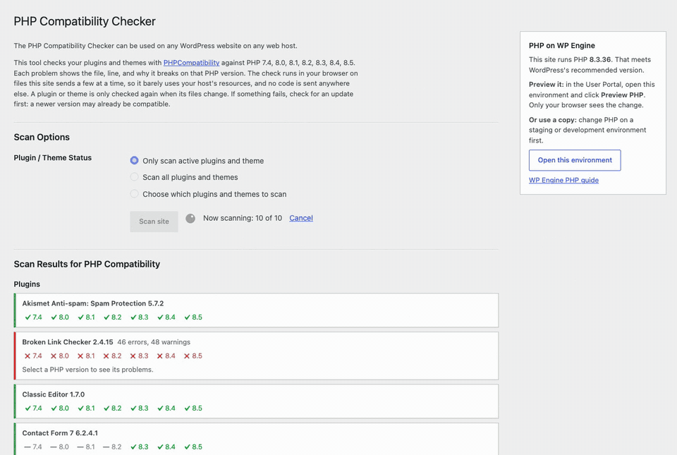
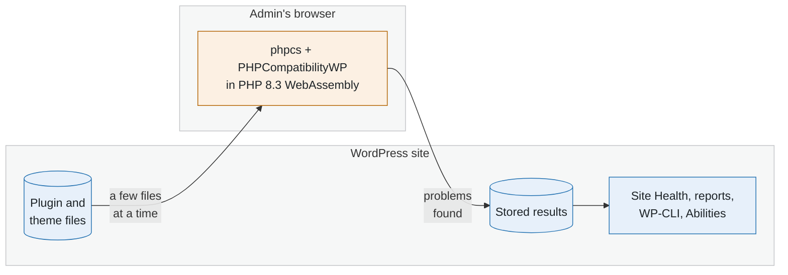
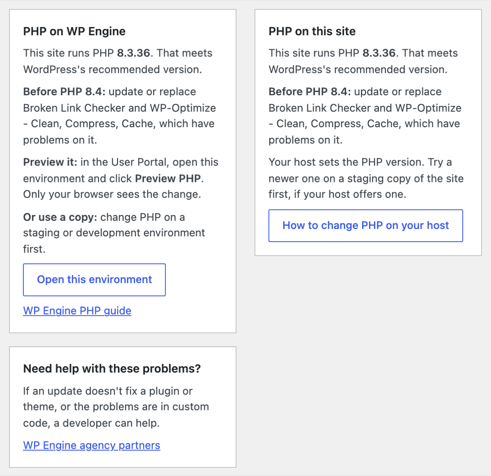

# PHP Compatibility Checker

[](https://github.com/josephfusco/phpcompat/actions/workflows/ci.yml)

A WordPress plugin that checks whether a site's plugins and themes work on PHP 7.4 through 8.5. It's on WordPress.org as [PHP Compatibility Checker](https://wordpress.org/plugins/php-compatibility-checker/), with around 200,000 active installs. This fork is where it's maintained before changes go upstream to [wpengine/phpcompat](https://github.com/wpengine/phpcompat).

<p align="center">
  
</p>

## How it works

It runs [PHPCompatibilityWP](https://github.com/PHPCompatibility/PHPCompatibilityWP) on every plugin and theme, including premium and custom code, and shows the file, line, and reason for each problem. The scan runs in the admin's browser, in PHP compiled to WebAssembly. The site only reads files, so the host barely notices, and no code leaves the site.



Results are reused until a plugin's files change. More: [how a scan works and why it's safe on shared hosting](docs/how-it-works.md).

## Works with any host

Beside the results, a panel shows the site's PHP version, which newer PHP it's ready for, and how to change PHP on this host. WP Engine is built in, hosts that already set a PHP guide URL for WordPress core get a panel linking to it, and any host can fill it in with the `wpephpcompat_host` filter ([example](docs/reference.md#host-panel)).

<p align="center">
  
</p>

## WP-CLI

```bash
wp php-compat scan --active             # Scan active plugins and theme (exits 1 on problems)
wp php-compat report wp-optimize --php=8.4
wp php-compat readiness --format=json   # Which newer PHP the site is ready for
```

`readiness` reads stored results only, so hosts can run it across many sites ([how](docs/readiness.md)). The [full reference](docs/reference.md) covers every command, the Abilities API, and filters.

## Local development

Requires Docker, Node.js 24 (`nvm use`), PHP 8.3+, and Composer.

```bash
npm ci && composer install && npm run build
npx wp-env start
```

WordPress runs at http://localhost:8888/wp-admin (`admin` / `password`). Go to **Tools → PHP Compatibility** and click **Scan site**.

```bash
composer test && composer lint       # PHP unit tests and coding standards
npm run test:unit && npm run lint:js # JS unit tests and lint
npm run test:e2e                     # Playwright, on a separate site at :8889
```

Code map, test setup, tooling, and releases: [docs/development.md](docs/development.md).

## Security

Please report security issues privately to wordpress@wpengine.com rather than opening a public issue.

## License

GPLv2 or later.
