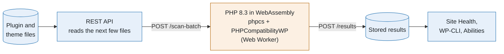

# PHP Compatibility Checker

[](https://github.com/josephfusco/phpcompat/actions/workflows/ci.yml)

A WordPress plugin that checks whether a site's plugins and themes work on PHP 7.4 through 8.5. It's on WordPress.org as [PHP Compatibility Checker](https://wordpress.org/plugins/php-compatibility-checker/), with around 200,000 active installs. This fork is where it's maintained before changes go upstream to [wpengine/phpcompat](https://github.com/wpengine/phpcompat).

<p align="center">
  
</p>

## How it works

It runs [PHPCompatibilityWP](https://github.com/PHPCompatibility/PHPCompatibilityWP) on every plugin and theme, including premium and custom code, and shows the file, line, and reason for each problem. The scan runs in the admin's browser, in PHP compiled to WebAssembly: the site only reads files, so it barely uses the host's resources, and nothing is sent to an outside service.



<sub>Blue runs on the WordPress site. Orange runs in the admin's browser.</sub>

Results are stored and reused until a plugin's files change. They also feed Site Health, PDF/CSV/JSON reports, WP-CLI, and the Abilities API.

More: [how a scan works and why it's safe on shared hosting](docs/how-it-works.md).

## WP-CLI

```bash
wp php-compat scan --active             # Scan active plugins and theme (exits 1 on problems)
wp php-compat report wp-optimize --php=8.4
wp php-compat readiness --format=json   # Which newer PHP the site is ready for
```

`readiness` reads stored results only, so hosts can run it across many sites. See [reading results across many sites](docs/readiness.md) and the [full reference](docs/reference.md) (all commands, Abilities API, PHP release status, filters).

## Local development

Requires Docker, Node.js 24 (`nvm use`), PHP 8.3+, and Composer.

```bash
npm ci && composer install && npm run build
npx wp-env start
```

WordPress runs at http://localhost:8888/wp-admin (`admin` / `password`). Go to **Tools → PHP Compatibility** and click **Scan site**.

```bash
composer test && composer lint       # PHP unit tests and coding standards
npm run test:unit && npm run lint:js # JS unit tests and lint
npm run test:e2e                     # Playwright, on a separate site at :8889
```

Code map, test setup, tooling, and releases: [docs/development.md](docs/development.md).

## Security

Please report security issues privately to wordpress@wpengine.com rather than opening a public issue.

## License

GPLv2 or later.
