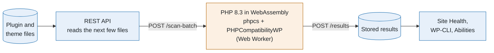
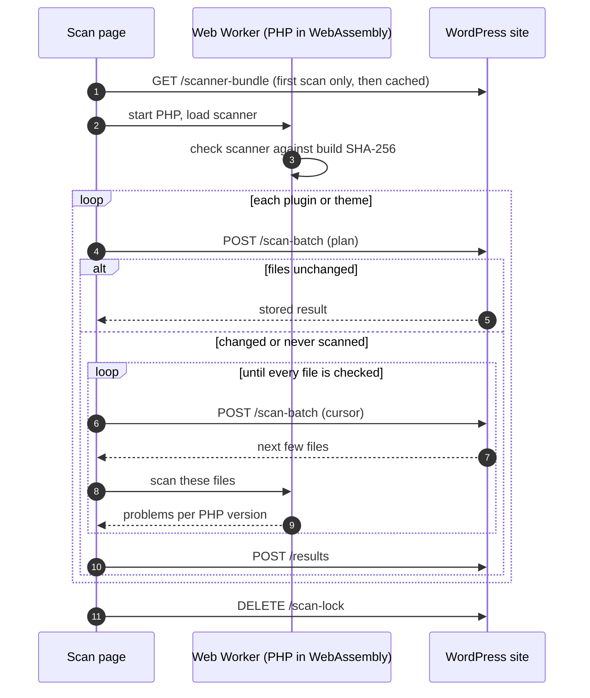
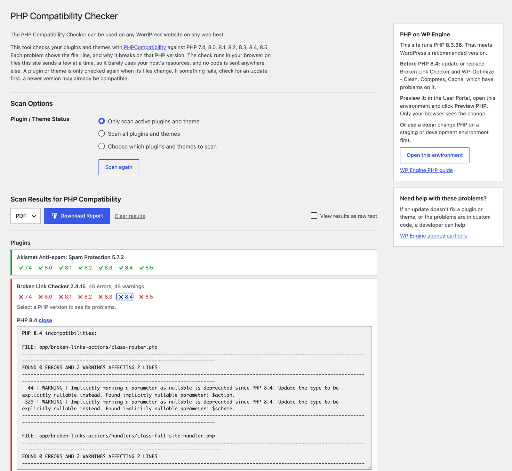
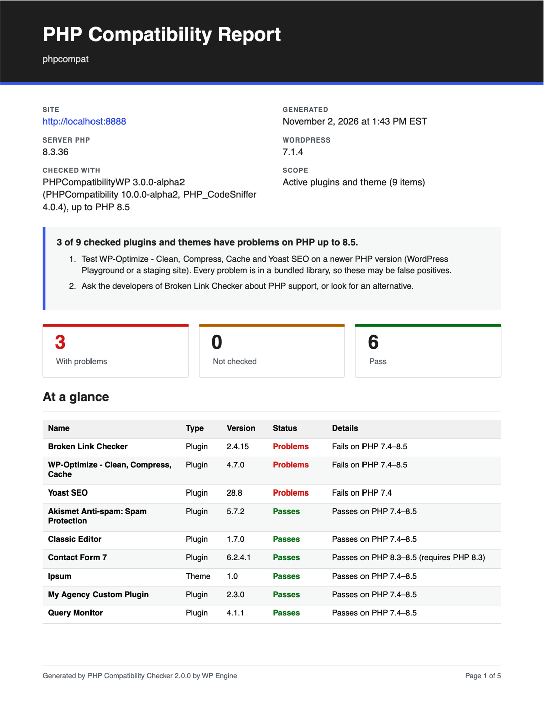
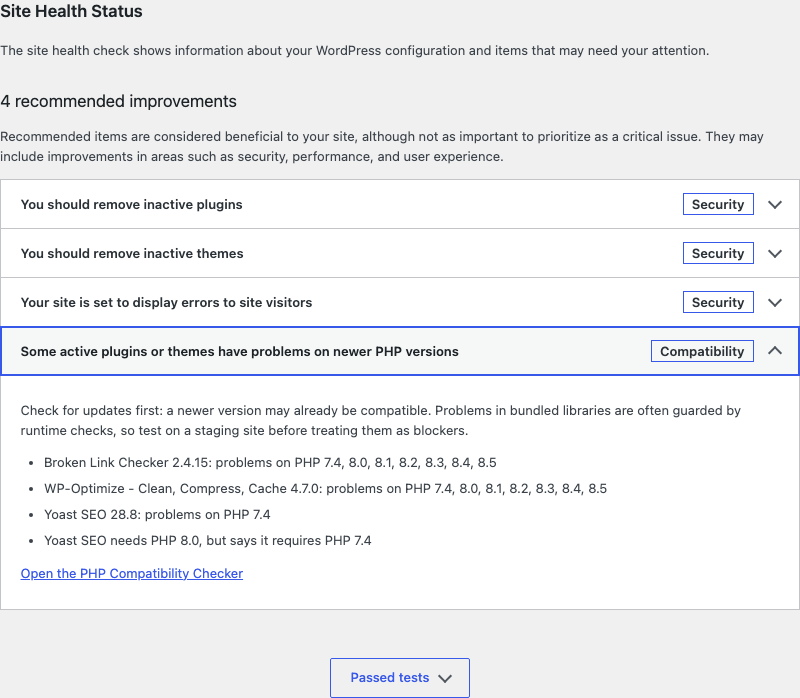
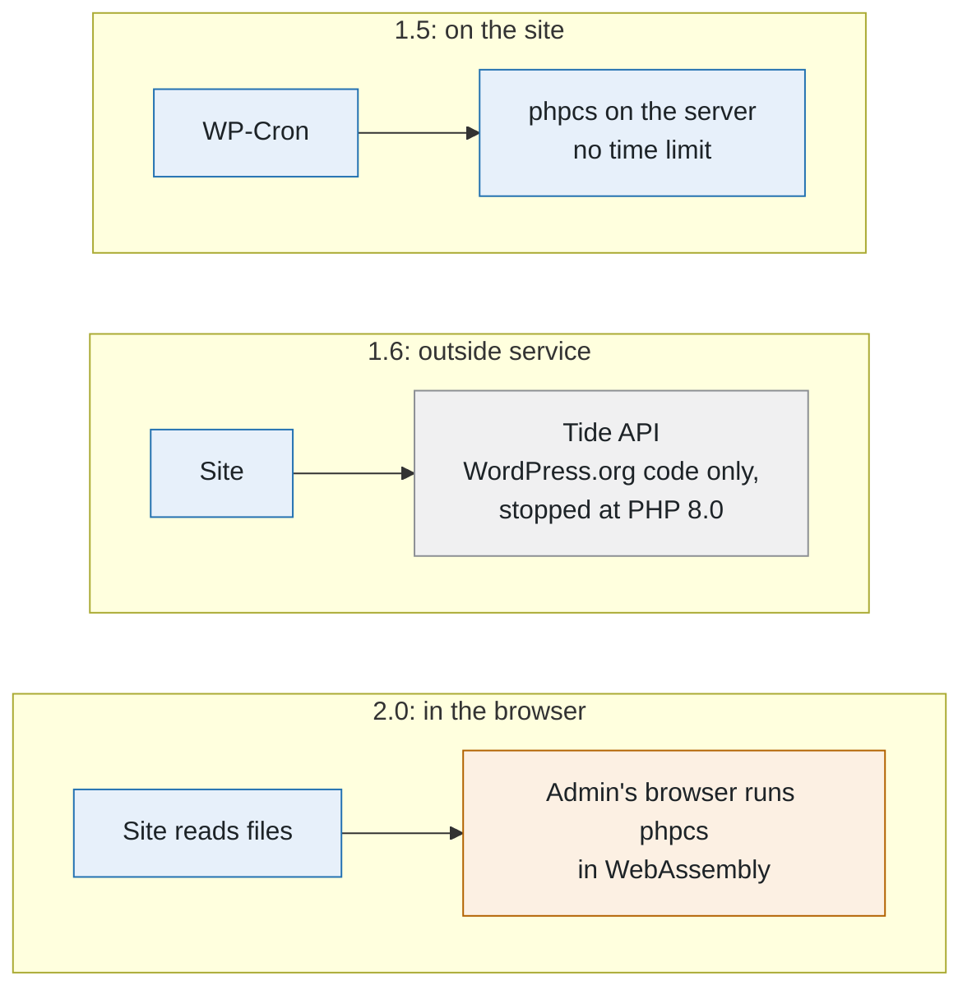

# How it works

The scan page (**Tools → PHP Compatibility**) runs the scan in the admin's browser. The plugin ships PHP 8.3 compiled to WebAssembly ([`@php-wasm/web-8-3`](https://www.npmjs.com/package/@php-wasm/web-8-3), from WordPress Playground) and runs its own copy of PHP_CodeSniffer and PHPCompatibilityWP in a Web Worker. The site only lists and reads files; the code never leaves the site and that browser.

Blue runs on the WordPress site. Orange runs in the admin's browser.

Step by step:

1. **Start PHP.** On the first scan the page downloads the scanner's files (`GET /scanner-bundle`), checks them against the SHA-256 in the plugin's build manifest, and keeps them in the browser's Cache Storage. The PHP runtime (`build/php-wasm/`, about 18 MB) loads from the plugin's own folder and the browser caches it. Both download again only when the plugin is updated. Browsers with JSPI (Chrome, Edge) use that build; Firefox and Safari use the Asyncify build.
2. **Plan.** The first request for each item (`POST /scan-batch`) returns the stored result if the item's files haven't changed, otherwise how many PHP files it has.
3. **Batches.** Each following request returns the next few PHP files. The worker writes them into PHP's in-memory file system and runs `runner.php`, the same file WP-CLI runs on the server. PHP inside the worker has no network access and no WordPress; it reads those files and prints JSON.
4. **Per-version results.** `runner.php` runs PHPCompatibilityWP once per PHP version (`testVersion` 7.4, 8.0, … 8.5), so each result means "this code breaks on PHP 8.x". To keep that fast, a first pass checks every file against the whole range and only the files it flags get the per-version passes.
5. **Merge and store.** The browser merges the batches. Each item gets a status (Passes, Problems found, Not checked) and a chip per PHP version. Versions below the item's own "Requires PHP" are shown as not counted. Errors fail a version; warnings (deprecations) are listed but still pass. Selecting a failing version shows the file, line, and message for each problem. The result is saved (`POST /results`) with the item's version, the scanner's rule set, and a fingerprint of its PHP files (paths, sizes, modification times). Later scans reuse it until any of those change.

  

The results also feed:

- **Site Health** (Tools → Site Health): a test for the active plugins and theme, and a PHP Compatibility section on the Info tab. It reads stored results and never scans.
- **"Requires PHP" checks**: an item whose code only passes from a newer PHP than its header says, or whose `vendor/composer/platform_check.php` requires one, gets a note. Both sources keep themselves current.
- **WP-CLI and the Abilities API**, which read the same stored results.

| PDF report | Site Health |
| --- | --- |
|  |  |

## Built for shared hosting

The plugin moved to an outside service (WP Engine's Tide, now retired) because 1.5 scanned on the site from WP-Cron with no time limit, which caused noisy-neighbor problems. 2.0 doesn't need a service: the expensive part runs in the browser, and what's left on the site is reading files.

Locally, Broken Link Checker (569 PHP files) takes about 22 seconds. The site spends 2.2 seconds of that reading files, over 16 requests, the longest 0.17 seconds. Scanning the same plugin on the server took about 10 seconds with requests up to 3.7 seconds, so a scan takes longer but the site does a fraction of the work. Results are identical to a server-side scan in Chromium, Firefox, and WebKit.

Scanning is a resumable batch job, using the usual patterns for that:

- **Only while the page is open.** No cron and no background jobs.
- **One scan per site, one request in flight.** A short lock (renewed by each request, gone two minutes after the last) keeps a second admin or tab from starting another scan, and each scan sends one request at a time, so it holds at most one PHP worker.
- **Server-side caps**: every batch is limited to 100 files and 1 MB, whatever the browser asks for.
- **Adaptive batch size**: each batch (request plus checking) aims for about 2 seconds, grows (at most 1.5×) while batches are fast, and halves after a slow or failed one.
- **Pacing**: after a slow request, it waits a quarter of that time (at most 3 seconds) before the next, so a busy host has room for visitors.
- **Progress you can see**: each item shows files checked, a progress bar, an estimate of the time left, and "still working…" if a batch takes longer than 10 seconds.
- **Retries with exponential backoff and jitter** on 429, 503, timeouts, and dropped connections, honoring `Retry-After`.
- **Poison-file isolation**: a batch that crashes PHP in the worker is split until the file causing it is found; that file is skipped and listed, and the worker restarts PHP. If more than a few files crash, the item fails instead of passing.
- **Optimistic concurrency**: if an item's files change mid-scan, the server answers 409 and the item starts again.
- **Integrity check**: the worker refuses scanner files that don't match the build's SHA-256, and the site checks its own copy once a day per build, so a missing or incomplete install says to reinstall instead of failing on every file.
- **An off switch**: `define( 'WPEPHPCOMPAT_DISABLE_SCANNING', true );` in `wp-config.php`, or the `wpephpcompat_scanning_enabled` filter, turns scanning off. Stored results, Site Health, and WP-CLI keep working.

## Limitations

- **Static analysis.** Code isn't executed. Code paths that exist for backwards compatibility can show up as failures, and runtime problems won't show up at all.
- **PHPCompatibility 10 is in alpha.** It's the release line with PHP 8.1–8.5 checks; coverage of some PHP 8.3–8.5 changes is still being added upstream. The exact versions are in every report and in `build/scanner.json`.
- **The browser does the work.** WebAssembly PHP is about 3–4× slower per file than native PHP, so a first scan of a large site takes a few minutes and the tab has to stay open. Later scans only check what changed. WP-CLI (`wp php-compat scan`) runs the same scanner natively on the server.
- **A bigger plugin.** The bundled PHP runtime makes the zip about 15 MB.
- **Multisite.** Only super admins can scan from the page, because scanning reads plugin code.
